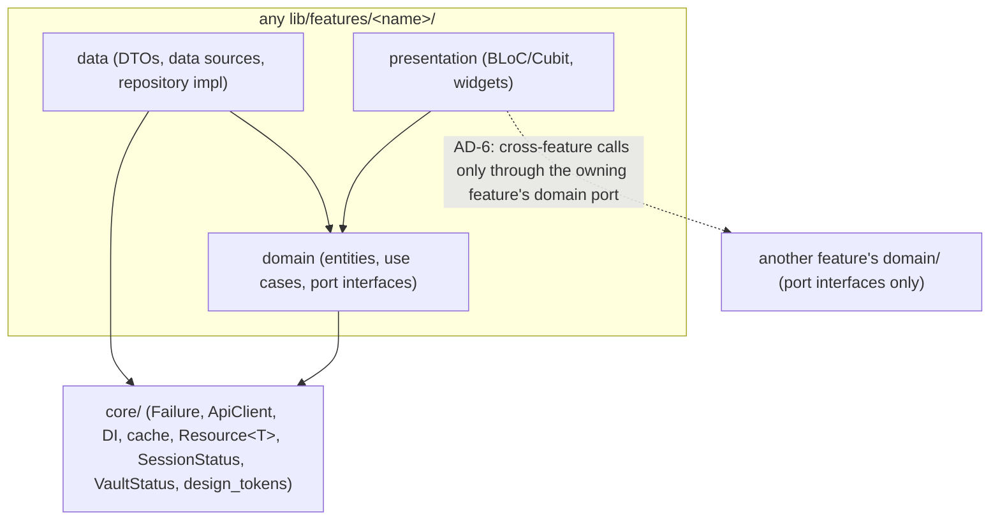
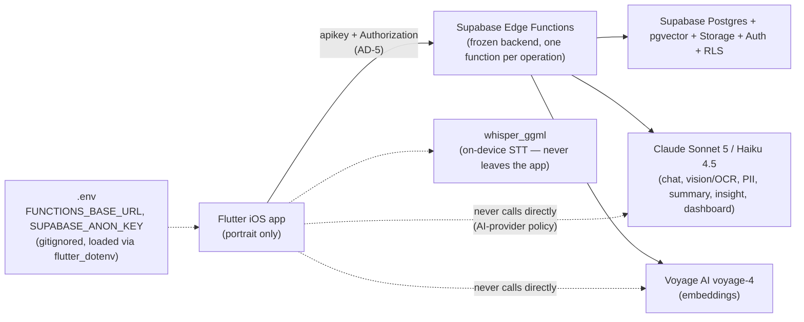

# Architecture Spine — Cerne

## Design Paradigm

**Clean Architecture, 3 layers per feature, BLoC on top, errors carried as values.**

- `presentation/` (BLoC/Cubit + widgets) → depends on → `domain/` (entities, use cases, repository/port interfaces) ← implemented by ← `data/` (DTOs, data sources, repository implementations).
- `domain/` is the only layer every other layer may depend on; it depends on nothing feature-specific and never on `package:flutter` (RNF06).
- Every operation that can fail (network, parse, local I/O) returns `Either<Failure, T>` (`fpdart`) at the repository boundary — no repository throws past itself (RNF09).
- `core/` sits beneath every feature and holds the only cross-feature-shared code: the `Failure` hierarchy, the API client/URL builder, the DI bootstrap, the local-cache boxes, `Resource<T>`, `isolatedSideEffect`, design tokens, and the `SessionStatus` contract.



## Invariants & Rules

### AD-1 — Layer dependency direction (RNF06)

- **Binds:** all features
- **Prevents:** `domain/` depending on Flutter, on any `data/` (own or another feature's), or on another feature's `presentation/`.
- **Rule:** dependency direction is strictly `presentation → domain ← data`. `domain/` imports neither `package:flutter` nor anything under any `data/`. Only `data/` imports `dio`/`hive_ce`/platform plugins. `presentation/` never imports a feature's own or another feature's `data/` directly.

### AD-2 — Either-everywhere error channel (RNF09)

- **Binds:** all repositories (read and write)
- **Prevents:** a feature inventing its own error signaling (exceptions crossing the repository boundary, nullable returns, ad hoc string errors) that other code can't pattern-match generically.
- **Rule:** every repository method returns `Future<Either<Failure, T>>` (or `Stream<Either<Failure, T>>` for the chat SSE stream). `Failure` is the closed hierarchy in AD-3. No repository implementation lets a native/dio exception escape unmapped.

### AD-3 — Closed `Failure` hierarchy `[ADOPTED]`

- **Binds:** all
- **Prevents:** two features inventing different shapes for "network timeout," or silently dropping one of the server's 13 codes.
- **Rule:** one sealed `Failure` class in `core/`, exactly 14 subtypes — the 13 from `error-taxonomy.md` (`AuthExpired`, `AuthInvalid`, `NetworkTimeout`, `NetworkOffline`, `Validation`, `PiiCheckFailed`, `EmbeddingFailed`, `AiGenerationTimeout`, `NotFound`, `RateLimited`, `ExportEmptyPeriod`, `PayloadTooLarge`, `OcrNoText`) plus the local-only `MalformedResponse` (`retryable` hardcoded `false`, for the client's own parse-failure detection). Never redefined or subset per feature. `AuthInvalid` can only ever originate from `POST /auth/login` — no biometric/PIN check ever reaches the server (AD-14), so no feature maps a local vault failure to this code.

### AD-4 — Retry policy lives in exactly one place `[ADOPTED]`

- **Binds:** the API client
- **Prevents:** a feature writing its own retry loop that double-retries, or retries a `retryable:false` code.
- **Rule:** retry logic is implemented once (the `dio` interceptor / `ApiClient` wrapper), fires only for the 6 server `retryable:true` codes (`NETWORK_TIMEOUT`, `NETWORK_OFFLINE`, `PII_CHECK_FAILED`, `EMBEDDING_FAILED`, `AI_GENERATION_TIMEOUT`, `RATE_LIMITED`). Every other code surfaces once, unretried.

### AD-5 — Function-name URL construction and header policy

- **Binds:** every network call
- **Prevents:** a feature string-concatenating the literal `openapi.yaml` REST path (which is not a real URL) or re-deciding which `Authorization` value to send.
- **Rule:** one URL builder in `core/` maps each operation to `{FUNCTIONS_BASE_URL}/<x-cerne-function>/<path-params>`. One `dio` interceptor owns headers: `apikey` on every call; `Authorization: Bearer <anon key>` only on the three `security: []` operations (signup, login, refresh); `Authorization: Bearer <user token>` on every other (`bearerAuth`) operation.

### AD-6 — `entries` owns `Entry` from RF01 onward; every other feature reaches it only through a domain-layer port

- **Binds:** RF01 (capture → entries, the *first* consumer — delivery order builds RF01 three units before RF06/RF07), RF10 (chat → entries), and any future cross-feature dependency
- **Prevents:** (a) RF01 inventing its own local `Entry` model/repository/cache box because `features/entries/` "doesn't exist yet" at its position in the delivery order, which RF06/RF07 would then duplicate; (b) any feature reaching into `entries`'s `data/`, repository, data source, or BLoC — the exact violation RF10's acceptance criteria calls out, which would also break RNF06.
- **Rule:** `features/entries/` is scaffolded at RF01 (not RF06/RF07) because RF01 is the first unit that must call `POST /entries` (requirements.md §6.2). From RF01 on, `entries/domain` owns the `Entry` entity, the `EntriesRepository` port (`create`, `read` — see AD-11), and the entries Hive box. `entries` exposes an abstract `CreateEntryUseCase`/`SaveEntryUseCase`-shaped port; RF01's `capture` feature and RF10's `chat` feature are both *consumers* — each only ever imports and injects that abstract type from `entries/domain`, never anything from `entries/data/` or `entries/presentation/`. RF06/RF07 extend the same `EntriesRepository` port with `list`/`search` methods; they do not introduce a second entry model or a second owner. The port's `create` is idempotent on `(origin, chatMessageId)`: a second call for a `chatMessageId` that already has an entry never creates a duplicate — the implementation (not the port's type signature) is responsible for this check, binding on RF10's build.

### AD-7 — No BLoC-to-BLoC references

- **Binds:** all (generalizes RF07's explicit AC to every feature)
- **Prevents:** hidden coupling and circular-rebuild chains between presentation units built independently.
- **Rule:** a BLoC/Cubit constructor never takes another BLoC/Cubit as a dependency, same-feature or cross-feature. Composition of multiple independent state sources happens by injecting the underlying `domain/` streams/use-cases into each BLoC independently, or via `BlocListener`/`MultiBlocListener` in the widget tree — never a direct BLoC → BLoC reference.

### AD-8 — Single `SessionStatus` source of truth

- **Binds:** F000 (go_router redirect), RF07 (composite auth × sync × data state), any feature that needs session validity
- **Prevents:** two independently-built screens disagreeing on what "session expired" means or when to prompt re-login.
- **Rule:** exactly one `SessionStatus` stream, exposed from the auth feature's `domain/`, registered once in DI as a singleton. Every consumer injects/listens to that stream; none re-derives session state from a raw 401, from its own `GET /auth/session` poll, or from a second stream. `SessionStatus` governs *server session validity only* — it composes with the local vault gate per AD-14, it does not replace it.

### AD-9 — Cloud-only: no offline write queue

- **Binds:** all repositories (generalizes RF06's "cloud-only" note and RF04's "blocked offline" writes)
- **Prevents:** a feature building a local write-queue/outbox that silently diverges from "offline permits viewing cached data only."
- **Rule:** a write attempted with no connectivity resolves immediately to `Either.left(Failure.networkOffline)` — it is never queued for later. Plain reads (`GET /entries`, `GET /chat/sessions`, `GET .../messages`) transparently fall back to the local `hive_ce` cache. **Semantic search is the one read exception:** `GET /entries/search` has no client-side vector index to fall back to, so with no connectivity it also resolves to `Either.left(Failure.networkOffline)`, same as a write — it is never served from cache. The only client-side "pending write" state is transient, in-memory, scoped to one in-flight request (it feeds AD-10's `Synchronizing` badge state) — it is never persisted as a queue.

### AD-10 — Sync badge is a pure client-side derivation (locks `sync-badge.md`)

- **Binds:** every screen that renders the per-entry sync badge (chat save confirmation, My Records list, any future one)
- **Prevents:** two screens computing `Synchronizing`/`Error`/`Synchronized` differently.
- **Rule:** one derivation function lives in `entries/domain`, computed from three inputs: `Entry.serverRevision`, `Entry.updatedAt`, and the transient per-entry write state (AD-9) — which is itself one of three values: no pending write (→ `Synchronized`), a write in flight (→ `Synchronizing`), or the in-flight write's `Future` resolved to `Left(Failure)` (→ `Synchronization error`, held until the next write attempt reconciles it). Every screen consumes that function's output; none recomputes the badge inline. The server never supplies a `sync_status` field — `requirements.md` §8 is wrong on this point (`sync-badge.md` and the `Entry` schema win).

### AD-11 — Entry immutability

- **Binds:** the entries feature
- **Prevents:** a unit speculatively adding an update/delete path the backend doesn't support.
- **Rule:** `EntriesRepository` exposes create and read operations only. No update or delete method is ever added, matching the backend's lack of `PATCH`/`DELETE /entries/:id`.

### AD-12 — Shared view-state scoped to single-source-of-truth fetches `[ADOPTED]`

- **Binds:** RF06 (search results), RF09 (dashboard aggregate/narrative) — explicitly *not* RF02, RF04, or RF07
- **Prevents:** forcing a composite or multi-stage state machine into a generic fetch enum, and the reverse: ad hoc one-off state shapes where a shared one would do.
- **Rule:** generic `Resource<T>` (`idle`/`loading`/`data`/`error`) lives in `core/`, used only by screens with one data source and one fetch lifecycle. RF02's capture pipeline (`recording`/`processing`/`transcribed`/`error`), RF07's composite auth × sync × data state, and RF04's chat message stream (append-only, streaming/SSE, not a single fetch) each define their own sealed state class — never forced into `Resource<T>`. RF08's proactive-insight overlay is a value appended onto RF04's existing chat state, not a parallel `Resource<T>`.

### AD-13 — `isolatedSideEffect` contract fixed now, implementation deferred `[ADOPTED]`

- **Binds:** RF08, RF10 (both state the identical failure-isolation requirement)
- **Prevents:** RF08 reinventing its own failure-isolation wrapper (or importing RF10's feature-local one), producing two incompatible "never block the caller on failure" implementations.
- **Rule:** `core/` holds a never-throws helper with signature `Future<Either<Failure, T>> Function(Future<T> Function())`-shaped (never throws past itself); it ships with RF10, delivery order's first consumer (RF04 → RF10 → RF08), not built speculatively in F000. The helper's own `Future` always completes independently of the caller: RF10 may `await` it before updating its button state, and RF08 must be able to call it **without** awaiting (fire-and-forget) so a slow/failed insight generation never blocks or delays the chat stream. RF08 reuses it from `core/` without a cross-feature import.

### AD-14 — One `go_router` redirect composes exactly two gates, in a fixed order: vault, then session

- **Binds:** F000 (builds the redirect skeleton + `SessionStatus` half), RF03 (plugs the vault half into the same redirect)
- **Prevents:** F000 and RF03 each building an independent navigation gate (two competing `redirect` callbacks, or RF03 bolting a second check onto screens individually) — `go_router` supports only one top-level `redirect`, so two independently-built gates cannot both "just work."
- **Rule:** the redirect composes exactly two domain-level streams, evaluated in this order: (1) `VaultStatus` (local-only — biometric/PIN unlocked, Face-ID-failed-offer-PIN, or locked after the 5-minute background timeout; RF03 exposes it from `features/vault/domain` the same way auth exposes `SessionStatus`, AD-8) — checked *first*, before any network state, because it gates whether the app may show anything at all; then (2) `SessionStatus` (AD-8) once the vault is unlocked. Neither gate ever reaches the server to validate itself (`POST /auth/login` is the only path that can produce `AuthInvalid`, per AD-3) — the vault is validated entirely on-device, consistent with the backend having no biometric-unlock endpoint.

### AD-15 — The local cache is a projection, never a query engine

- **Binds:** `entries`, `chat` — every feature with a `hive_ce` box `[ADOPTED, promoted from the F000 forge session]`
- **Prevents:** a unit adding local filtering, joining, or sorting logic "for performance" or "for offline support," which would then disagree with the server's own filter semantics (AD-9's offline read rule assumes the cache's content is a verbatim copy, not a re-derived view).
- **Rule:** every query dimension (`source`, `dateFrom`/`dateTo`, semantic search, pagination cursor) is a server-side query parameter per `openapi.yaml`. A `hive_ce` box stores exactly what the server returned, keyed by id (or by session id for messages); no feature ever filters, joins, sorts, or re-derives a different view from a cached collection — a cache miss or a dimension not covered by AD-9's offline-read rule surfaces `Failure.networkOffline`, it is never approximated locally.

## Consistency Conventions

| Concern | Convention |
| --- | --- |
| Feature naming | `lib/features/<feature>/` one of: `auth`, `vault`, `capture`, `entries`, `chat`, `export`, `dashboard`, `account` — see Capability → Architecture Map |
| Errors | `Failure` sealed hierarchy (AD-3) everywhere; UI maps a `Failure` to copy using its `retryable` flag, never a hardcoded per-screen message list |
| IDs & dates | server-assigned string IDs and ISO-8601 timestamps passed through verbatim from DTOs (`freezed`+`json_serializable`); the client never generates or reformats an entity ID |
| Visual values | `lib/core/design_tokens.dart` only (RNF08) — no color/font/spacing/radius literal anywhere else |
| Network envelope | one `ApiClient`/URL-builder + one header interceptor (AD-5); no feature constructs a request URL or header set itself |
| State composition | `Resource<T>` for single-source fetches (AD-12); no BLoC-to-BLoC references (AD-7) |
| Testing | `mocktail` stubs one `ApiClient` interface per repository test, not a fake transport layer; one shared table-driven helper drives the 5-write-endpoints × 3-failure-types = 15-scenario matrix (RNF09); ≥80% line coverage gate on every `domain/` (RNF07) |
| Config/secrets | `.env` (`FUNCTIONS_BASE_URL`, `SUPABASE_ANON_KEY`) loaded via `flutter_dotenv` `[ASSUMPTION — settled here; requirements.md left it "free," no prior session decided it]`; never committed, never hardcoded |
| AI provider access | the app never calls Claude or Voyage AI directly — every AI-backed feature goes through the backend's documented endpoints (project policy, binding on all features) |
| Local cache | `hive_ce` boxes are a projection of server responses, never a query engine (AD-15) |
| Pagination/cursor | every paginated list (`entries`, `entries/search`, `chat_sessions`, `chat_messages`) uses the server's own cursor convention verbatim; the cursor string is cached alongside the box it pages (AD-15) — `entries` and `entries/search` share one cursor convention since both live in the one `entries` feature (AD-6) |
| Fixed numeric parameters (`requirements.md` §10 — not reinterpretable) | background session timeout 5 min (RF03) · search debounce 300 ms (RF06) · proactive-insight trigger N=5 user messages OR T=2 min inactivity, fires once per satisfied condition (RF08) · dashboard rendering scenarios 0 / 1 / >30 entries (RF09) · local UI latency <100 ms, loading indicator threshold >300 ms (RNF01) · domain coverage ≥80% (RNF07) · 5 write endpoints × 3 failure types = 15 scenarios (RNF09) — each is implemented inside its owning feature (not a shared core constant), but none may be approximated or re-tuned by whichever unit builds it |

## Stack

<!-- Versions web-verified 2026-10-26; the project's pubspec.yaml owns the exact pin once F000 scaffolds it. -->

| Name | Version |
| --- | --- |
| Flutter SDK | 3.47.x stable family (pin the exact patch via `fvm` at F000 time) |
| flutter_bloc | ^9.1.1 |
| go_router | ^18.1.1 |
| dio | ^5.11.1 |
| hive_ce + hive_ce_flutter | ^2.22.0 |
| get_it | ^9.3.0 |
| fpdart | ^1.2.0 |
| freezed + freezed_annotation | ^4.0.3 |
| json_serializable | ^6.15.2 |
| build_runner | latest compatible with the pinned Dart SDK |
| mocktail | ^1.0.5 |
| fl_chart | ^1.3.0 |
| local_auth | ^3.0.2 |
| flutter_secure_storage | ^11.2.0 |
| flutter_dotenv | ^6.0.1 |
| whisper_ggml | ^2.8.1 |

## Structural Seed

```text
lib/
  core/
    design_tokens.dart        # RNF08 — the only source of color/font/spacing/radius
    network/                  # ApiClient, URL builder, header + retry interceptor (AD-4, AD-5)
    failure/                  # sealed Failure hierarchy, 14 subtypes (AD-3)
    di/                       # get_it instance + bootstrap that calls each feature's registerXFeature()
    cache/                    # hive_ce boxes: entries, chat_messages, chat_sessions + cursor
    resource.dart             # Resource<T> (AD-12)
    isolated_side_effect.dart # never-throws Either wrapper (AD-13)
    session/                  # SessionStatus contract (AD-8) — implemented by features/auth
  features/
    auth/          # F000 — signup, login, refresh, logout, SessionStatus (owns AD-8)
    vault/         # RF03 — biometric/PIN gate, 5-min background timeout, VaultStatus (owns the vault half of AD-14)
    entries/        # RF01 introduces it (owns Entry, EntriesRepository.create, sync badge AD-10, SaveEntryUseCase port AD-6); RF06/RF07 extend it with list/search (My Records screen)
    capture/        # RF01, RF02 — Insertion Modal (text/audio/photo), on-device Whisper STT, OCR call; consumes entries' port (AD-6), owns no Entry data itself
    chat/            # RF04, RF08, RF10 — Home chat, RAG, proactive insight, save-to-journal button (consumes entries' port, AD-6)
    export/          # RF05 — summary export job, PDF + raw download
    dashboard/       # RF09 — aggregate + narrative, fl_chart rendering
    account/         # RNF05, Settings — persona toggle (extension, inert), delete account, logout
```



## Capability → Architecture Map

| Capability / Area | Lives in | Governed by |
| --- | --- | --- |
| F000 — scaffold, tokens, HTTP client, auth, base nav | `core/`, `features/auth/` | AD-1..AD-5, AD-8, AD-14 (session half) |
| RF03 — biometric/PIN vault | `features/vault/` | AD-14 (vault half), AD-3 (`AuthInvalid` note) |
| RF01 — multimodal capture | `features/capture/` → `features/entries/` (introduces it) | AD-1, AD-2, AD-6, AD-9, AD-15 |
| RF02 — STT/OCR processing | `features/capture/` | AD-12 (excluded — own state machine) |
| RF07 — multi-source history (timeline) | `features/entries/` (extends with timeline read) | AD-7, AD-8, AD-10, AD-12 (excluded), AD-15 |
| RF06 — semantic search/filter | `features/entries/` (extends with search) | AD-9 (search carve-out), AD-12, AD-15 |
| RF04 — chat with memory (RAG) | `features/chat/` | AD-1, AD-2, AD-9, AD-12 (own stream, excluded) |
| RF10 — save chat message as entry | `features/chat/` → `features/entries/` | AD-6 (idempotency), AD-13 |
| RF08 — proactive insights | `features/chat/` | AD-12 (overlay on chat state), AD-13 (fire-and-forget) |
| RF05 — personal summary export | `features/export/` | AD-1, AD-2 |
| RF09 — temporal summaries/dashboard | `features/dashboard/` | AD-12 |
| RNF05 — account deletion, settings | `features/account/` | AD-1, AD-2 |

## Deferred

- **Epic/story breakdown within each build unit** — this spine fixes cross-unit invariants, not per-story task sequencing; owned by `bmad-create-epics-and-stories`.
- **CI/CD pipeline and release process** — no CI tool, test-runner wiring, or App Store distribution step is specified anywhere in the input package, and no project deadline is stated (flagged as an open PRD question). Revisit once a submission/demo deadline exists.
- **Exact fvm-pinned Flutter/Dart patch and the real `flutter test`/`flutter analyze` invocations** — `AGENTS.md`'s "Running and verifying" section leaves these open until F000 scaffolds the project; this spine names the current stable family (3.47.x), not a committed patch.
- **Persona system-prompt wiring and manual-tag UI behavior** — both are explicit extension features (`requirements.md` §2) that receive no functional implementation; no architecture owns their logic.
- **Dashboard cache-invalidation behavior (RF09 AC)** — a presentation-layer concern for whichever unit builds RF09, not a local-cache architecture decision.
- **Combined search + filter interaction semantics** when both a search term and date/source filters are active — flagged as an open PRD question (blocks RF06); `requirements.md` §6 fixes AND-logic between two *filters*, but search-term-plus-filter combination is still open. Resolve at RF06 build time, not here.
- **Product-level open questions carried from the PRD, not resolved here because they're not architecture-level:** signup field set (password confirmation / display name — blocks F000), tab-switching mid-capture in the Insertion Modal (discard/warn/persist — blocks RF01), whether the sync-badge error state needs a visible retry affordance or reconciliation-on-next-write is sufficient (blocks RF07). None of the three changes an AD in this spine regardless of how they're answered; each is a product decision for the unit that builds it.
- **Integration spike flagged, not yet run:** `dio` + `flutter_secure_storage` + `get_it` have not been verified working together in one scaffold (each is independently current per the Stack table, but their combination at F000's bootstrap time is unverified). Run this as the first thing F000 does, before building on top of it.
