# Cerne — Requirements and Screen Flow

Cerne is a reflective-journaling mobile app with an AI assistant. The user records their day by text, audio or photo; a conversational agent consults those records (semantic search) to answer with context and to offer insights.

This document is the product specification. The visual reference is the prototype in `docs/input/prototype/`; the backend API is documented in `docs/input/backend/`.

---

## 1. Functional requirements

### RF01 — Multimodal capture (text / audio / photo)
Data entry by text, real-time audio recording and photo upload — always through Screen 2 (Insertion Modal), which has a raw text field in addition to the microphone and the gallery. Every capture becomes a persisted record (`POST /entries`), **distinct from a chat message** (see the separation note in RF04).

**Acceptance criteria:**
- The three modalities (text, audio, photo) result in the same persisted-entry format — none is treated structurally differently from the others after capture.
- Cancelling a capture midway (e.g., interrupting a recording) does not create a partial or empty entry.

### RF02 — Speech-to-text / OCR processing
Transcription of audio (speech-to-text) and recognition of text in images (OCR) over the content captured in RF01.

**Acceptance criteria:** four visible states — recording, processing, transcribed, transcription error.

### RF03 — Biometric authentication vault
Access barrier via Face ID / Touch ID / PIN before exposing the user's data.

**Acceptance criteria:**
- A biometric failure (e.g., fingerprint not recognized) offers PIN as an alternative, without locking the user out of the app.
- The app, sent to the background and resumed after 5 minutes, requires authentication again — it does not stay unlocked indefinitely (fixed value, not configurable by the user).

### RF04 — Interactive chat with memory (RAG)
Continuous conversation with the AI agent, with semantic search over previous entries. **Chat messages are conversational and do not create journal entries automatically** — the only exception is the explicit save action described in RF10. Otherwise, the chat queries existing entries via RAG but does not write to them.

**Acceptance criteria:**
- Three mandatory UI states: processing/streaming, error, complete response.
- If the response stream drops midway, the partial message stays visible with a failure indication (it does not disappear).

### RF05 — Personal summary export
Generation of a narrative summary by AI (Claude Haiku 4.5) from the user's entries, exportable as PDF, with an additional option to download the raw data without the narrative. No clinical or diagnostic connotation. **Scope: job generation, file download and failure handling — never the quality of the generated narrative text.**

**Acceptance criteria:**
- An export job with zero entries in the period returns a handled error state (not an empty PDF, not a crash).
- A failure generating the narrative text (model timeout) still allows downloading the raw data without the narrative — the export is not blocked by an AI failure.

### RF06 — Semantic search / filter over journal entries
Semantic similarity search (via Voyage AI embeddings, reusing the ones already generated in RF01) combined with metadata filters (date, entry type). There is no filter by tag or category: the backend does not implement it in any endpoint — `GET /entries` and `GET /entries/search` accept only `source` and `dateFrom`/`dateTo`. Tags appear only embedded, read-only, in the `Entry` object (see section 2).

**Acceptance criteria:**
- Searching for a term finds semantically related entries even without the exact word (e.g., searching "ansiedade" returns an entry that only mentions "nervosismo", without the literal term).
- 300 ms search debounce: fast typing triggers a single query, not one per keystroke.
- Results from the local read cache stay consistent with the server after reconnection, without duplicating displayed items *(the architecture is cloud-only; offline allows only viewing already-cached data, not writing)*.
- Two or more filters applied at the same time (`source` + `dateFrom`/`dateTo`) narrow results with AND logic (not OR).
- Clearing the filters returns to the full list without restarting the screen.

### RF07 — Multi-source history (timeline)
A screen whose state depends simultaneously on authentication, synchronization status and entry data.

**Acceptance criteria:**
- Session expiration while viewing triggers a new-login prompt without a crash and without losing the scroll position.
- The per-entry synchronization status badge updates independently of the authentication stream.
- No BLoC imports another BLoC directly.

### RF08 — Proactive insights (mechanism)
A suggestion inserted into the chat without the user asking for it. **Scope: only the trigger mechanism, never the quality of the generated text.**

**Acceptance criteria:**
- Trigger after N = 5 user messages OR T = 2 min of inactivity — fires exactly once per satisfied condition.
- If insight generation fails (timeout / network error), the main chat keeps working normally.
- Dismissing the insight does not change the scroll position or the state of the main conversation.

### RF09 — Temporal summaries / dashboard
An evolution chart with a textual summary, computed on demand when the Settings tab is opened. **Scope: aggregation and rendering, never the quality of the narrative text.**

**Acceptance criteria:**
- Renders correctly in three scenarios: zero entries, one entry, more than 30 entries.
- The aggregation recalculates correctly after an entry is created (cache-invalidation test). Entries are immutable: there is no `PATCH /entries/:id` or `DELETE /entries/:id` in the backend, and no screen describes an edit or delete action on an entry.
- The AI narrative text is checked only for not breaking the UI in extreme cases — never for its content.

### RF10 — Save a chat message as an entry
A button on each user message in the chat that converts it into a persisted entry — for moments when the user states relevant information during the conversation, not only through dedicated capture (RF01). It reuses the same `POST /entries` pipeline (PII check + embedding), with the origin marked as `chat`.

**Acceptance criteria:**
- The chat feature triggers the creation of the entry through a shared interface / use case, never by directly importing a repository or data source of the entries feature — a violation here also breaks RNF06.
- Saving the same message twice does not create duplicate entries (idempotency).
- A failure to save (network unavailable) keeps the conversation working normally, and the button returns to a state that allows trying again — the same failure-isolation pattern as RF08.
- Only user messages have the button — AI responses cannot become entries.

---

## 2. Extension features — not implemented

They keep the "essence" of the original product flow and exist in the prototype, but **receive no functional implementation**. A menu entry may exist as a placeholder.

| Original feature | Treatment in the current version |
|---|---|
| Dynamic categorization (AI) | Simplified to manual tags created by the user (My Records screen) |
| Autonomous goal extraction | Action Plans screen — static, no logic |
| Dynamic persona adjustment | Simple cosmetic toggle (Settings), low cost to maintain |

---

## 3. Quality requirements

| ID | Requirement | Target |
|---|---|---|
| RNF06 | Zero layer violations — the domain layer does not import `package:flutter` nor classes from `data/` | 0 violations |
| RNF07 | Minimum test coverage of the domain layer (`lib/**/domain/**`) | ≥ 80% |
| RNF08 | Visual fidelity to the prototype — the primary color matches the prototype's hex value, typography matches family and size, spacing matches the prototype; no visual value hardcoded outside the central file `design_tokens.dart` | Every screen faithful in color, typography and spacing; 0 hardcoded values |
| RNF09 | Consistent network-error handling — `Either<Failure, T>` pattern via `fpdart` in every repository; every write endpoint (5 endpoints) handles three failure types — timeout, malformed response, no connection — covered by tests with `mocktail` | 0 repository signatures outside the pattern; 15 of 15 scenarios handled |

## 4. Other non-functional requirements

RNF01 — Interaction latency (a local action is reflected in the UI in < 100 ms; any network call above 300 ms shows a loading indicator) · RNF02 — PII stripping (via Claude Haiku 4.5 with a structured prompt / tool use, not a dedicated NER model) · RNF03 — Zero data retention · RNF04 — RLS (Row Level Security) · RNF05 — Hard delete of account and data (LGPD).

**Known limitation:** the system has no protocol for detecting or responding to risk signals (suicidal ideation, self-harm) in entries or chat messages. Since the product is not framed as a mental-health app, this absence is an explicit scope decision.

---

## 5. Interface architecture and screen flow

### 5.1 Visual foundation (design system)
Minimalist identity, a warm and neutral palette, readable sans-serif typography, standardized components (buttons, chat bubbles, cards). This foundation is the direct object of RNF08. Tokens: `docs/input/prototype/prototype-extract.md`.

### 5.2 Screens

**Screen 0 — Splash:** initial loading; checks the connection and syncs the cache in the background. *Connects to: RF06, RNF01.*

**Screen 0.1 — Authentication vault:** biometric/PIN barrier before access. *Connects to: RF03.*

**Screen 1 — Home (chat):** main screen, continuous conversation, "+" button for multimodal input, AI status indicator, "save to journal" button on each user message. *Connects to: RF04, RF08, RF10, RNF01, RNF09.*

**Screen 2 — Insertion Modal:** overlay with three ways to capture — raw text field, microphone (audio) and gallery/camera (photo) — with a transcription indicator. Every capture here creates a persisted entry, never a chat message. *Connects to: RF01, RF02.*

**Screen 3 — Side menu (sidebar):** navigation hub, session history, access to My Records / Action Plans / Settings, and a "Novo Chat" button that opens Screen 1 in its empty state. *Connects to: RF04 (via the "Novo Chat" button); the other items are pure navigation.*

**Screen 4 — My Records:** consolidated timeline, filters, manual tags (extension, section 2), export. *Connects to: RF07, RF06, RF05.*

**Screen 5 — Action Plans:** simple Kanban board (columns "A Fazer" / "Em Andamento" / "Concluído") with static example cards. *(Extension — section 2.)*

**Screen 6 — Settings and profile:** evolution dashboard, persona selector — "Analítico" / "Empático" / "Socrático" (extension, section 2; it would only change the system-prompt string of RF04), delete account. *Connects to: RF09, RNF05.*

---

## 6. Backend endpoint inventory

The backend is already built and frozen. The API contract, `docs/input/backend/api/openapi.yaml`, is the source of truth; this section is a reading of it oriented by screen and requirement. How to build the real URL of each operation: `docs/input/backend/README.md`.

Every endpoint returns errors in the standard contract of RNF09 — `{ code, message, retryable }` — and is protected by RLS in Supabase. AI providers: Claude (chat, vision/OCR, summary, insights, dashboard, PII detection) and Voyage AI (embeddings) — the backend's only two external AI dependencies. Audio transcription (speech-to-text) runs on-device (Whisper) and never reaches the backend as an audio file.

### 6.1 Authentication and session
| Endpoint | Requirement | AI involved |
|---|---|---|
| `POST /auth/signup` | RF03 | — |
| `POST /auth/login` | RF03 | — |
| `POST /auth/refresh` | RF03, RF07 | — |
| `GET /auth/session` | RF07 | — |
| `POST /auth/logout` | RF03 | — |

**No "biometric-unlock" endpoint — intentional:** the Face ID / Touch ID / PIN barrier of Screen 0.1 is validated entirely on the device, never on the server. The backend only stores the preference (`biometricEnabled`, read and written via `PATCH /account/settings`, section 6.7) — it validates no biometrics. After passing the local barrier, the app uses the existing session (renewed via `POST /auth/refresh` when needed, or `POST /auth/login` if it has fully expired).

### 6.2 Ingestion and entries
| Endpoint | Requirement | AI involved |
|---|---|---|
| `POST /media/ocr` — the image is not persisted; only the extracted text moves on | RF02 | Claude Haiku 4.5 (vision) |
| `POST /entries` — creates an entry; internally triggers the PII check and embedding generation; accepts `source` (`manual`/`audio`/`photo`/`chat`) and `chatMessageId` when the origin is the chat | RF01, RF02, RF10 | Claude Haiku 4.5 (PII) + Voyage AI (embedding) |
| `GET /entries` — filters by `source`/`dateFrom`/`dateTo`; tags appear only embedded in the response, read-only | RF07 | — |
| `GET /entries/:id` | RF07 | — |

**No entry editing or deletion, and no tag endpoint — intentional:** entries are immutable once created ("original content intact, never censored"); there is no `PATCH`/`DELETE /entries/:id`. Tags are populated only by test seed data — no endpoint creates, deletes or filters by tag or category (see RF06). This is consistent with section 2: dynamic categorization was simplified to manual tags that receive no functional implementation.

### 6.3 Chat and memory (RAG)
| Endpoint | Requirement | AI involved |
|---|---|---|
| `POST /chat/sessions` — blocked offline | RF04 | — |
| `GET /chat/sessions` — works offline (cache) | RF04, RF07 | — |
| `GET /chat/sessions/:id/messages` — works offline (cache) | RF04 | — |
| `POST /chat/sessions/:id/messages` — streaming (SSE); blocked offline | RF04 | Voyage AI (question embedding) + Claude Sonnet 5 (response) |
| `POST /chat/sessions/:id/messages/:userMessageId/retry` — regenerates the response without duplicating the user's question; it supports "partial message visible with a failure indication, and a way to try again" in RF04 | RF04 | Voyage AI (embedding, reused from cache) + Claude Sonnet 5 (response) |
| `POST /chat/sessions/:id/insight` | RF08 | Claude Haiku 4.5 |
| `POST /entries` — called from the "save to journal" button (see 6.2) | RF10 | Claude Haiku 4.5 (PII) + Voyage AI (embedding) |

### 6.4 Search
| Endpoint | Requirement | AI involved |
|---|---|---|
| `GET /entries/search?q=&source=&dateFrom=&dateTo=&limit=` — no `category` (see RF06) | RF06 | Voyage AI (query embedding) |

### 6.5 Export
| Endpoint | Requirement | AI involved |
|---|---|---|
| `POST /export/summary` — asynchronous job | RF05 | Claude Haiku 4.5 |
| `GET /export/:jobId/status` | RF05 | — |
| `GET /export/:jobId/download` | RF05 | — |

### 6.6 Dashboard
| Endpoint | Requirement | AI involved |
|---|---|---|
| `GET /dashboard/aggregate?period=` — separate from the text so it does not block the chart | RF09 | — |
| `GET /dashboard/narrative?period=` | RF09 | Claude Haiku 4.5 |

### 6.7 Account
| Endpoint | Requirement | AI involved |
|---|---|---|
| `PATCH /account/settings` — includes the persona toggle (extension) | RNF05, extension | — |
| `DELETE /account` | RNF05 | — |

---

## 7. Integrated flowchart — screens × requirements × backend

```mermaid
flowchart TD
    subgraph T0["Screen 0 — Splash"]
        direction TB
        E01["GET /auth/session"]
    end

    subgraph T01["Screen 0.1 — Authentication vault · RF03"]
        direction TB
        E02b["Face ID / Touch ID / PIN — validated on the device, no backend call"]
        E02["POST /auth/login (if the session has fully expired)"]
    end

    subgraph T1["Screen 1 — Home (chat) · RF04, RF08, RF10"]
        direction TB
        E04["POST /chat/sessions"]
        E05["GET /chat/sessions/:id/messages"]
        E06["POST /chat/sessions/:id/messages"]
        E06b["POST .../messages/:userMessageId/retry"]
        E07["POST /chat/sessions/:id/insight"]
        E07b["POST /entries (save message)"]
    end

    subgraph T2["Screen 2 — Insertion modal · RF01, RF02"]
        direction TB
        E08["POST /media/ocr"]
        E09["POST /entries"]
    end

    subgraph T3["Screen 3 — Side menu"]
        direction TB
        E10["GET /chat/sessions"]
        E10b["'Novo Chat' button — opens T1 empty, backed by E04"]
    end

    subgraph T4["Screen 4 — My records · RF05, RF06, RF07"]
        direction TB
        E11["GET /entries (source/dateFrom/dateTo — no category)"]
        E12["GET /entries/search"]
        E15["POST /export/summary"]
        E15b["GET /export/:jobId/status"]
        E16["GET /export/:jobId/download"]
    end

    subgraph T5["Screen 5 — Action plans (extension)"]
        direction TB
        E17["No calls — static"]
    end

    subgraph T6["Screen 6 — Settings · RF09, RNF05"]
        direction TB
        E18["GET /dashboard/aggregate"]
        E19["GET /dashboard/narrative"]
        E20["PATCH /account/settings"]
        E21["DELETE /account"]
        E22["POST /auth/logout"]
    end

    T0 --> T01 --> T1
    T1 --> T2
    T1 --> T3
    T3 -->|Novo Chat| T1
    T3 --> T4
    T3 --> T5
    T3 --> T6

    style T5 fill:#FAEEDA,stroke:#BA7517,color:#412402
```



*(The amber "Action plans" subgraph marks the only screen with no backend calls — a product extension.)*

---

## 8. Data model (reference)

Main entities of the backend (Supabase / Postgres). Field names are reference suggestions, not mandatory character by character. **Where this table differs from the API contract (`docs/input/backend/api/openapi.yaml`), the contract prevails** (see section 6).

| Table | Main fields | Notes |
|---|---|---|
| `users` | id, email, biometric_enabled, persona, created_at | RLS: a user accesses only their own row |
| `entries` | id, user_id, content, source (`manual`/`audio`/`photo`/`chat`), chat_message_id (nullable), embedding (vector, see 9), sync_status, created_at, updated_at | `embedding` generated in `POST /entries` via Voyage AI |
| `tags` | id, user_id, name | Extension — created manually by the user |
| `entry_tags` | entry_id, tag_id | N:N join table |
| `chat_sessions` | id, user_id, title, created_at | — |
| `chat_messages` | id, session_id, role (`user`/`assistant`), content, created_at | User messages show the RF10 button |
| `export_jobs` | id, user_id, status (`pending`/`processing`/`done`/`error`), period_start, period_end, file_url, created_at | Asynchronous — see 6.5 |

**RLS pattern (every table with `user_id`):** policy `auth.uid() = user_id`, no exceptions.

---

## 9. Technology stack

| Layer | Choice |
|---|---|
| Mobile app | Flutter, BLoC, Clean Architecture |
| Backend | Already built and frozen; consumed through its API |
| Infrastructure | Supabase (Postgres + pgvector + Storage + Auth + RLS) |
| Chat / vision / OCR / summary / insights / dashboard / PII | Claude Sonnet 5 (chat) + Claude Haiku 4.5 (the rest) — in the backend |
| Embeddings (RAG) | Voyage AI `voyage-4` — in the backend |
| Speech-to-text (audio transcription) | Whisper on-device (`whisper_ggml`); audio never reaches the backend |
| Error handling | `fpdart` (`Either<Failure, T>`) |
| Layer rule | RNF06 |
| Test coverage | RNF07 |

---

## 10. Configuration parameters

Fixed values — not to be reinterpreted.

| Parameter | Value | Requirement |
|---|---|---|
| Background session timeout | 5 min | RF03 |
| Search debounce | 300 ms | RF06 |
| Proactive insight trigger | 5 messages OR 2 min of inactivity | RF08 |
| Dashboard rendering scenarios | 0 / 1 / > 30 entries | RF09 |
| Minimum test coverage (domain) | ≥ 80% | RNF07 |
| Local UI latency | < 100 ms | RNF01 |
| Loading-indicator threshold | > 300 ms | RNF01 |
| Network-error scenarios tested | 5 endpoints × 3 failures = 15 | RNF09 |

---

## 11. Error codes (RNF09)

Every endpoint returns `{ code, message, retryable }`. Minimum codes the app handles:

| Code | Situation | `retryable` |
|---|---|---|
| `AUTH_EXPIRED` | Session expired, re-authentication needed | no |
| `AUTH_INVALID` | Invalid credentials / biometrics | no |
| `NETWORK_TIMEOUT` | Request exceeded the time limit | yes |
| `NETWORK_OFFLINE` | No connection — action blocked (see RF04/RF06) | yes |
| `VALIDATION_ERROR` | Malformed request body | no |
| `PII_CHECK_FAILED` | PII check failed before persisting | yes |
| `EMBEDDING_FAILED` | Voyage AI unavailable / error | yes |
| `AI_GENERATION_TIMEOUT` | Claude did not respond in time (chat/insight/summary/dashboard) | yes |
| `NOT_FOUND` | Resource does not exist or does not belong to the user | no |
| `RATE_LIMITED` | Request limit exceeded | yes |

The complete, closed list of the backend's 13 codes, with HTTP statuses, is in `docs/input/backend/error-taxonomy.md`.

---

## 12. Delivery order

Work is delivered in units, one per functional requirement, preceded by a foundation unit, in this order:

**F000 → RF03 → RF01 → RF02 → RF07 → RF06 → RF04 → RF10 → RF08 → RF05 → RF09**

- **F000 (foundation)** covers what no single requirement owns but all of them use: project scaffold, `design_tokens.dart`, HTTP client returning `Either`, login and sign-up (Screen 0.1a in the prototype), base navigation and expired-session handling.
- RF10 comes after RF01 and RF04; RF08 comes after RF04.

---

## 13. Technical constraints

**Fixed:**
- Flutter and Dart at the version pinned for the repository (fvm).
- State management: `flutter_bloc`.
- Clean Architecture, three layers per feature.
- Error handling: `fpdart`; repositories return `Either<Failure, T>`.
- Test doubles: `mocktail`.
- On-device speech-to-text: `whisper_ggml`.
- Visual tokens: `lib/core/design_tokens.dart` is the single source of colors, typography, spacing and radii.
- Platform: iOS, portrait only.
- Folder convention:

```
lib/
  core/
  features/
    <feature>/
      data/
      domain/
      presentation/
```

**Free (choose what fits):** routing, HTTP client, local cache, dependency injection, secure storage, biometrics package, chart package.
